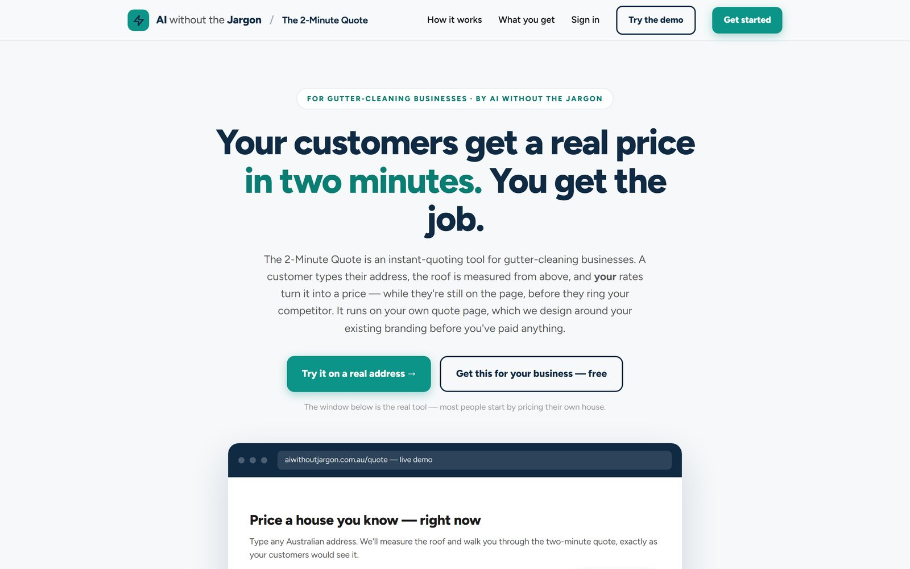
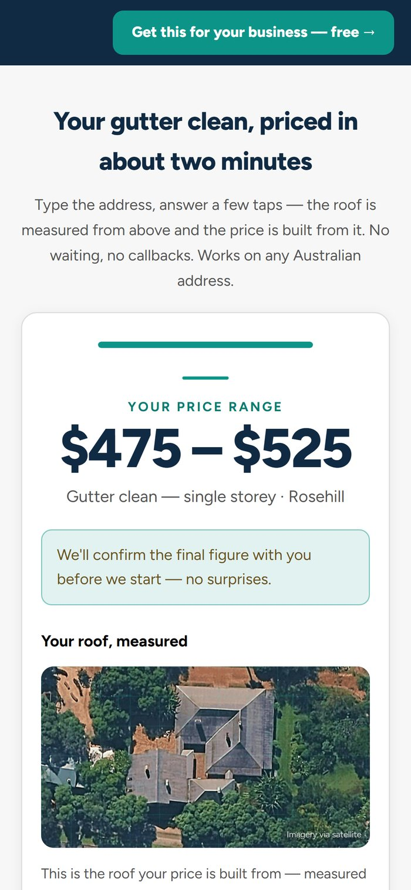
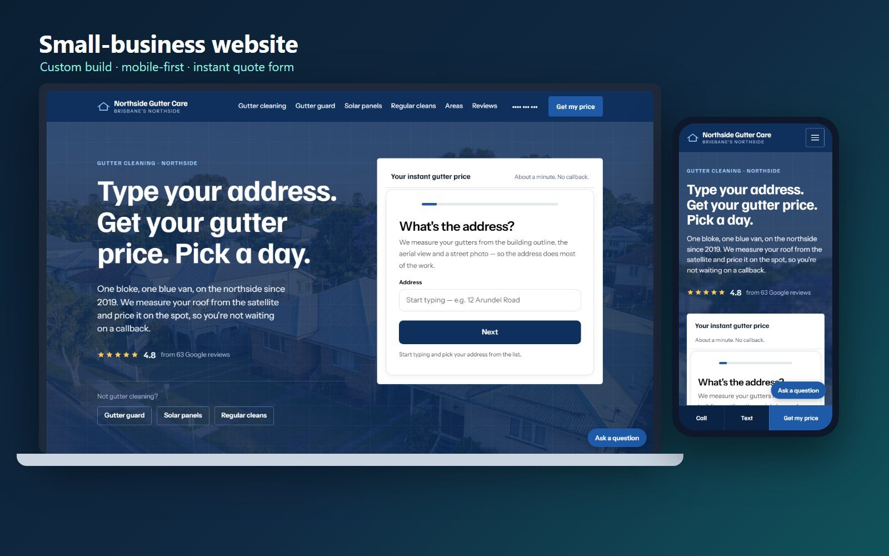
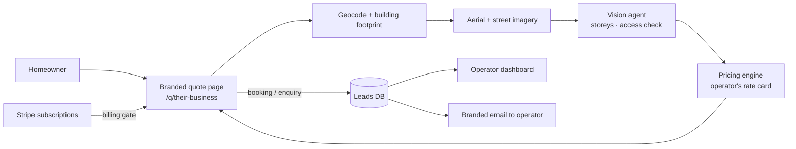

# The 2-Minute Quote: instant pricing SaaS for trade businesses

**Live product:** [aiwithoutjargon.com.au/gutter-cleaning](https://aiwithoutjargon.com.au/gutter-cleaning/). Try it on any Australian address.

A multi-tenant SaaS I designed, built and run. A homeowner types their address, the roof is measured from above, and the business's own rates turn it into a price while the customer is still on the page, before they ring a competitor. Gutter-cleaning businesses sign up, get their own branded quote page, and pay monthly by subscription.

> The source code is private because it's a commercial product with paying customers. This repo is a write-up with screenshots. I'm happy to walk through the code on a call.

---

## The customer side

<table>
<tr>
<td width="38%"></td>
<td>

1. **Type an address.** It's geocoded and matched to the building's footprint.
2. **The roof is measured.** Gutter length comes from the building outline and aerial imagery. A vision agent cross-checks storeys from a street-level photo, and it can only make a price *dearer*, never undercut the business.
3. **A few taps.** Storeys, roof access, add-ons. Customers can also add photos, which AI reads.
4. **A real price range,** built from the operator's own rate card, with an itemised breakdown showing how every number was reached.
5. **Book or send.** Depending on the operator's settings, the customer picks a day or sends their details. The job lands in the operator's dashboard and inbox.

</td>
</tr>
</table>

## The operator side

- **Self-serve signup:** business name and service area, and their branded quote page is built automatically. An AI designer agent copies their existing website header so the page looks like theirs.
- **Dashboard:** leads, bookings, prices (operators edit their own rates), branding (logo to colour palette), and a setup checklist.
- **Sign-in:** passwordless email codes plus Google sign-in. No passwords to leak.
- **Billing:** Stripe subscriptions with an in-page Payment Element, free trials, a customer portal for cancelling, and quote pages that switch off automatically when billing lapses.
- **Lead routing:** each business only ever sees its own leads, and every email is branded as theirs.
- **Embeddable:** it also runs inside an operator's own website. [Here's a demo site with it built in](https://aiwithoutjargon.com.au/northside-gutter-care/).

## Architecture

**Decisions worth noting**

- **The model never sets the price.** AI measures and checks; a deterministic engine prices from the operator's rate card, so every quote can be explained.
- **Layered imagery sources.** Several aerial and street-level sources are tried in order, so one provider going down doesn't stop quotes.
- **Never undercut the business.** The street-view check can only make a price dearer. When in doubt, the price errs towards the operator.
- **Validated output.** A validator stops a quote from mentioning services the operator doesn't offer.

## Built with

Node.js · SQLite · Stripe Billing and Payment Element · Claude agents (vision checks, page design) · Google Maps, Street View and government aerial imagery · Zoho transactional email · Caddy · pm2 · a Linux VPS

---

**Need instant quoting, a customer portal or Stripe billing built for your business?** Get in touch through my profile.
